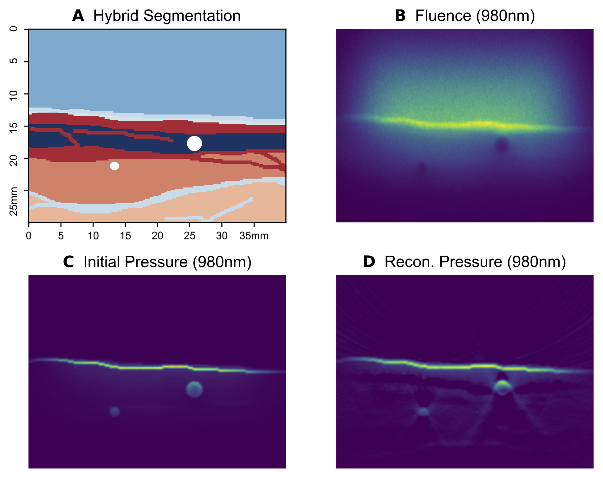
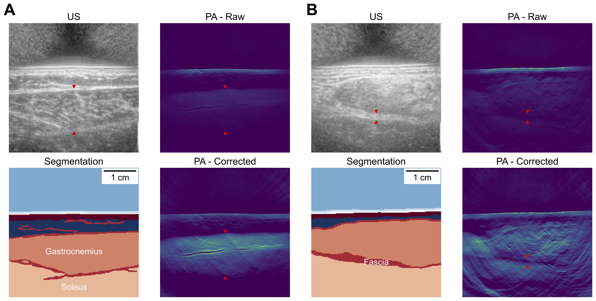
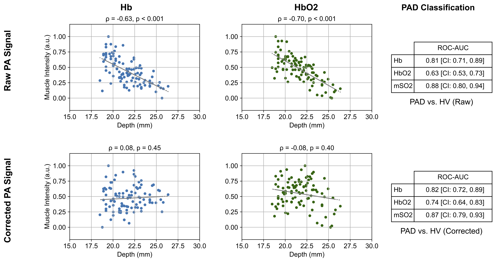
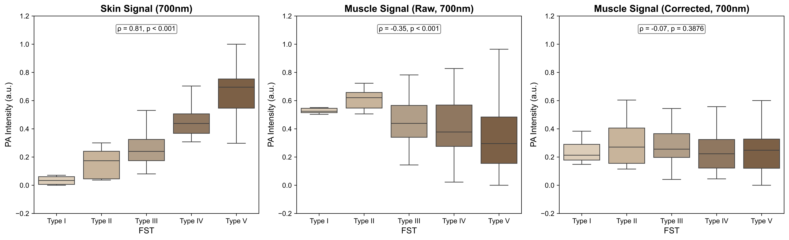
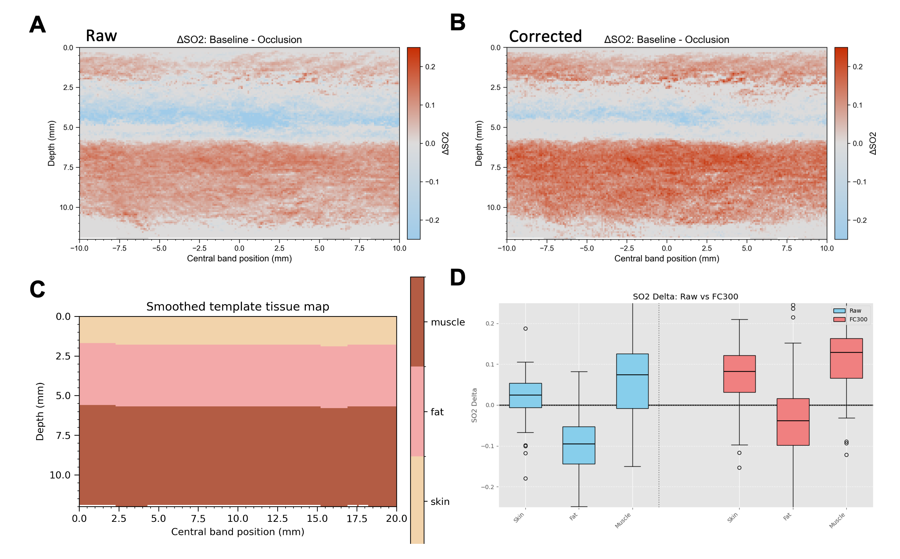

# Digital Twins for Fluence and Skin Tone Modeling

This repository describes the implementation for the publication:
Tissue-Aware Digital Twins for Fluence and Skin Tone Modeling in Photoacoustic Imaging [insert preprint]

### Abstract

*Quantitative photoacoustic imaging remains challenging because light fluence decays with depth and varies with wavelength, introducing strong biases in measured signal intensities. These effects distort chromophore estimates, obscure deeper structures, and cause skin-type–dependent variability, which can compromise diagnostic reliability. To address these limitations,
we present a subject-specific, physics-informed framework for fluence correction using anatomical information from co-registered ultrasound scans. A deep neural network segments key tissues to construct individualized digital twins with spatially varying optical parameter maps. Monte Carlo simulations generate in silico fluence estimates, which are used to correct the reconstructed in vivo photoacoustic image. Epidermal melanin content is estimated from the segmented epidermis and incorporated into the model to account for inter-subject variation in skin pigmentation. Evaluated on simulations and clinical datasets, our method reduces both depth-related bias and skin-type–associated signal variation, while maintaining or improving diagnostic performance. This enables large-scale, automated, and more equitable quantitative PAI analysis.*

## Datasets
The datasets were collected from:
- PAD Dataset: https://doi.org/10.1038/s43856-025-00801-1
- FST Dataset: [in preparation]

Sample data may be provided upon reasonable request.

## Overview

This project was realized using a number of frameworks:

### Custom SIMPA (this repository)
Optical and acoustic simulations were done using a modified version of the Simulation and Image Processing for Photonics and Acoustics (SIMPA) toolkit ([README](README_SIMPA.md)). Some of the custom changes include (PRs / branches are linked):
- Variable laser energy ([T428](https://github.com/IMSY-DKFZ/simpa/pull/428))
- Updated device parameters ([T416](https://github.com/IMSY-DKFZ/simpa/pull/429))
- Updated Acuity transducer geometry ([acuity-geometry-kwave](https://github.com/Mo-Sc/simpa/tree/acuity-geometry-kwave/simpa/core/simulation_modules/acoustic_module))
- Improved segmentation based volume creation ([T437](https://github.com/IMSY-DKFZ/simpa/pull/437))
- Partial volume effects for segmentation based volume creation ([T437](https://github.com/IMSY-DKFZ/simpa/pull/437))
- Bugfixes ([T427](https://github.com/IMSY-DKFZ/simpa/pull/427))

The simulation pipelines, including the tissue class mappings, that were used for the 3 datasets can be found in the [experiments folder](simpa/experiments/publication).

### Optoacoustic-Ultrasound-Analysis pipeline

The data extraction, segmentation and analysis was done using the [Ultrasound Segmentation / MSOT Analysis Pipeline](https://github.com/Mo-Sc/OA-US-Analysis-Pipeline), as described in https://doi.org/10.1117/12.3049067.

### Multiclass Ultrasound Segmentation
The segmentation network used to create the tissue maps is described in [sendero-us-segmentation](https://github.com/Mo-Sc/sendero-us-segmentation).

## Results

### Figure 2

Source: [SIM_Dataset_Samples.ipynb](experiments/publication/results/SIM_Dataset_Samples.ipynb).

**Fig. 2**. Representative sample from the simulated dataset. **A**: Hybrid
tissue mask, based on segmentation of in vivo scans, augmented by
artificial vessels. **B**: Fluence map after optical simulation at 980 nm.
**C**: Generated initial pressure distribution at 980 nm. **D**: Reconstructed
pressure after acoustic simulation and reconstruction at 980 nm.

### Figure 3

Source: [PAD_Dataset_Samples.ipynb](experiments/publication/results/PAD_Dataset_Samples.ipynb)

**Fig. 3.** Two representative samples from the PAD-Dataset, including US image, uncorrected PA image (700 nm), the segmentation mask that was used to generate the digital twin, and the corrected PA image. **A**: Enhanced gastrocnemius muscle. **B**: Improved visibility of the fascia, separating gastrocnemius and soleus muscle.

### Figure 4

Source: [PAD_Dataset_Results.ipynb](experiments/publication/results/PAD_Dataset_Results.ipynb)

**Fig. 4.** Relationship between chromophore estimates (Hb, HbO2) and the depth of the region from where they were extracted in the PAD-Dataset. Fluence correction reduces depth-related bias while maintaining or improving diagnostic performance.

### Figure 5

Source: [FST_Dataset_Results.ipynb](experiments/publication/results/FST_Dataset_Results.ipynb)

**Fig. 5.** Comparison of signal intensity at 700 nm across Fitzpatrick skin types before and after fluence correction. Strong positive correlations were observed in the skin layer, and weaker negative correlations in the muscle layer below. Correlations with skin type were fully removed after correction.

### Supplemental: Oxygen Saturation Change Heatmap

**Supplemental Fig.** Spatial changes in oxygen saturation between baseline and occlusion phase, summarized over all subjects. As expected, oxygen saturation decreases strongly in the skin and muscle layer. In the fat layer, we see a slight increase in saturation, which we attribute to spectral coloring. For more information: [insert FST paper]. After correction, the spectral coloring artefacts are reduced, while the change in skin and muscle becomes even more pronounced.
**A**: oxygen saturation changes before correction. **B**: oxygen saturation after correction. **C**: Average tissue layout, created from all subjects segmentation mask and used to warp each subjects oxygenation map into one layout. **D**: boxplot comparison for different layers pre and post correction.

## Parameter List
The following is an (in)complete list of parameters that were used for this project:

<table>
  <thead>
    <tr>
      <th>Category</th>
      <th>Parameter</th>
      <th>Value</th>
    </tr>
  </thead>
  <tbody>
    <tr><td><strong>Data Acquisition</strong></td><td>Device</td><td>MSOT Acuity Echo (iThera Medical GmbH)</td></tr>
    <tr><td></td><td>Wavelengths (PAD-Dataset)</td><td>700,730,760,800,850,910,930,950,980,1030,1080,1100,1210nm</td></tr>
    <tr><td></td><td>Wavelengths (FST-Dataset)</td><td>700,710,720,730,740,750,760,770,780,790,800,810,820,830,840, 850,860,870,880,890,900,910,920,930,940,950,960,970,980,990, 1000,1010,1020,1030,1040,1050,1060,1070,1080,1090,1100nm</td></tr>
    <tr><td></td><td>Probe Radius</td><td>40 mm</td></tr>
    <tr><td></td><td>Probe Height</td><td>43.2 mm</td></tr>
    <tr><td></td><td>Detector Elements</td><td>256</td></tr>
    <tr><td></td><td>Detector Element Width</td><td>0.24 mm</td></tr>
    <tr><td></td><td>Detector Element Length</td><td>13 mm</td></tr>
    <tr><td></td><td>Pitch</td><td>0.34 mm</td></tr>
    <tr><td></td><td>Central Frequency</td><td>3.96 MHz</td></tr>
    <tr><td></td><td>Bandwidth</td><td>1.53</td></tr>
    <tr><td><strong>Reconstruction</strong></td><td>Algorithm</td><td>Backprojection (iThera Medical GmbH)</td></tr>
    <tr><td></td><td>Speed of Sound</td><td>1540 m/s</td></tr>
    <tr><td></td><td>Pixel Size</td><td>0.1 mm</td></tr>
    <tr><td></td><td>Field of View</td><td>40 × 40 mm</td></tr>
    <tr><td></td><td>Image Shape</td><td>400 × 400 px</td></tr>
    <tr><td><strong>Unmixing</strong></td><td>Algorithm</td><td>Linear Unmixing (NNLS)</td></tr>
    <tr><td></td><td>Chromophores</td><td>Hb, HbO₂ (Prahl)</td></tr>
    <tr><td></td><td>Wavelengths</td><td>700, 850, 980 nm</td></tr>
    <tr><td><strong>Segmentation Network</strong></td><td>Architecture</td><td>U-Net (6 Stages)</td></tr>
    <tr><td></td><td>Input Size</td><td>224 × 224 px</td></tr>
    <tr><td></td><td>Loss Function</td><td>Dice Loss + Structural Loss</td></tr>
    <tr><td></td><td>Optimizer</td><td>Adam</td></tr>
    <tr><td></td><td>Training Epochs</td><td>100 (Early Stopping)</td></tr>
    <tr><td></td><td>Learning Rate</td><td>0.0001</td></tr>
    <tr><td><strong>Digital Twin</strong></td><td>Muscle Oxygenation</td><td>0.6</td></tr>
    <tr><td></td><td>Muscle Blood Volume Fraction</td><td>0.2</td></tr>
    <tr><td></td><td>Vessel Oxygenation</td><td>0.8</td></tr>
    <tr><td></td><td>Epidermis Thickness</td><td>0.1 mm</td></tr>
    <tr><td></td><td>Melanin Volume Fraction</td><td>1%–30%</td></tr>
    <tr><td></td><td>Skin Oxygenation (Baseline)</td><td>0.75</td></tr>
    <tr><td></td><td>Skin Oxygenation (Occlusion)</td><td>0.4</td></tr>
    <tr><td></td><td>Other Tissue Parameters</td><td>SIMPA</td></tr>
    <tr><td><strong>Simulation</strong></td><td>Device</td><td>MSOT Acuity Echo Device Twin</td></tr>
    <tr><td></td><td>Optical Model</td><td>MCX (SIMPA)</td></tr>
    <tr><td></td><td>Number of Photons</td><td>10,000,000</td></tr>
    <tr><td></td><td>Laser Pulse Energy (mJ)</td><td>11.25 (700 nm), 9.93 (850 nm), 6.5 (980 nm)</td></tr>
    <tr><td></td><td>Acoustic Model</td><td>kWave (SIMPA)</td></tr>
    <tr><td></td><td>Speed of Sound</td><td>1540 m/s</td></tr>
    <tr><td></td><td>Sampling Frequency</td><td>40 MHz</td></tr>
    <tr><td></td><td>Spacing</td><td>0.1 mm</td></tr>
    <tr><td></td><td>Random Seed</td><td>471</td></tr>
    <tr><td></td><td>Gaussian Noise Mean</td><td>1</td></tr>
    <tr><td></td><td>Gaussian Noise Std</td><td>0.01</td></tr>
  </tbody>
</table>